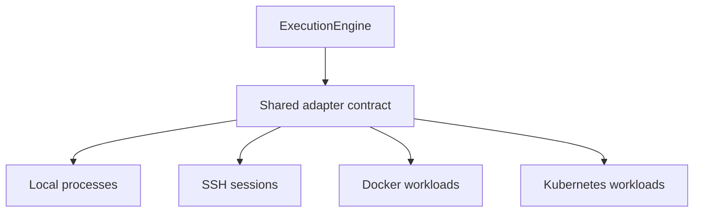

# Adapter Concept

An adapter connects the execution engine to an environment. Commands retain a
common result, cancellation and diagnostic contract while each adapter owns the
transport and process lifecycle required by its target.

## Adapter System Architecture



## Base Adapter Class

`BaseAdapter` is the internal implementation shared by the concrete adapters.
It merges command defaults, creates results, masks diagnostics and supplies
stream handling. The public package exports the engine and concrete adapter
classes. Configure the engine for normal command execution.

### Adapter Configuration

```typescript
import { ExecutionEngine, createCallableEngine } from '@xec-sh/core';

const engine = new ExecutionEngine({
  defaultTimeout: '30s',
  defaultCwd: process.cwd(),
  maxBuffer: 4 * 1024 * 1024,
});
const run = createCallableEngine(engine);
try {
  console.log(await run`node --version`.text());
} finally {
  await engine.dispose();
}
```

## Execution Lifecycle

### 1. Adapter Selection

Select the environment with its target API or the command's typed adapter
options. An ordinary `$` command uses the local adapter.

```typescript
import { $ } from '@xec-sh/core';

await $.ssh({ host: 'server', username: 'deploy' })`uname -s`;
await $.with({
  adapter: 'docker',
  adapterOptions: { type: 'docker', container: 'app' },
})`uname -s`;
await $`node --version`;
```

### 2. Command Preparation

Per-command values override defaults. Configuration methods return a target
with the requested settings and retain the shared adapter resources.

```typescript
import { $ } from '@xec-sh/core';

const build = $.cd(process.cwd()).env({ NODE_ENV: 'production' }).timeout('5m');
await build`npm run build`;
```

### 3. Execution

The engine invokes the selected adapter with the command, arguments and
execution options. For a local executable, `shell: false` preserves arguments
as separate values.

```typescript
import { $ } from '@xec-sh/core';

const result = await $.exec(process.execPath, {
  args: ['--version'],
  shell: false,
  timeout: '5s',
});
console.log(result.text());
```

### 4. Result Processing

Every completed command returns `ExecutionResult`. Its `ok` property considers
both the exit code and termination signal.

```typescript
import { $, type ExecutionResult } from '@xec-sh/core';

function summarize(result: ExecutionResult) {
  return { ok: result.ok, exitCode: result.exitCode, signal: result.signal, duration: result.duration };
}
console.log(summarize(await $`node --version`));
```

## Adapter Types

### LocalAdapter

The local adapter owns the operating-system process and its standard streams.

```typescript
import { $ } from '@xec-sh/core';
await $.local()`node --version`;
```

### SSHAdapter

SSH targets support connection reuse, verified host identities, transfers and
tunnels. An application should bind credentials and host verification policy to
its configured target.

```typescript
import { $ } from '@xec-sh/core';
const remote = $.ssh({ host: 'server.example.com', username: 'deploy', hostKeyChecking: 'strict' });
await remote`uname -s`;
```

### DockerAdapter

A container target executes commands inside an existing container. The fluent
Docker API also exposes service lifecycle and image-building operations.

```typescript
import { $ } from '@xec-sh/core';
await $.docker('app')`node --version`;
console.log(await $.docker().container('app').status());
```

### KubernetesAdapter

Pin cluster context and namespace alongside the pod. Pod operations share that
target across commands, logs, file copies and port forwarding.

```typescript
import { $ } from '@xec-sh/core';
const target = $.k8s({ pod: 'app-0', namespace: 'staging', context: 'staging' });
await target`node --version`;
console.log(await target.pod('app-0').logs({ tail: 20 }));
```

### Remote Docker (via SSH Composition)

Execute Docker commands on the remote host through its SSH target.

```typescript
import { $ } from '@xec-sh/core';
const remote = $.ssh('deploy@server.example.com');
await remote`docker exec app node --version`;
```

## Common Adapter Capabilities

### Stream Processing

Attach output callbacks before starting the command. The promise remains
awaitable and preserves the final execution result.

```typescript
import { $ } from '@xec-sh/core';
await $`npm run build`.stdout(chunk => { process.stdout.write(chunk); });
```

### Sensitive Data Masking

Register credentials that may appear in unlabelled output. The shared boundary
uses registered values and recognized credential patterns in diagnostics.

```typescript
import { registerSecret } from '@xec-sh/core';
const secret = process.env.SERVICE_TOKEN;
if (!secret || !registerSecret(secret)) throw new Error('A valid SERVICE_TOKEN is required');
```

### Timeout Handling

The adapter owns the command deadline, cancellation and termination reporting.

```typescript
import { $, ExecutionError } from '@xec-sh/core';
try {
  await $`npm test`.timeout('5m');
} catch (error) {
  if (error instanceof ExecutionError) console.error(error.kind);
  throw error;
}
```

### Adapter Events

Subscribe to typed events on the engine.

```typescript
import { $ } from '@xec-sh/core';
$.on('command:complete', event => {
  console.log(event.adapter, event.exitCode, event.duration);
});
$.on('ssh:disconnect', event => {
  console.error(event.host, event.reason);
});
await $`node --version`;
```

## Creating Your Own Adapter

The public `registerAdapter` method accepts the engine's adapter contract.
`BaseAdapter` currently remains internal, so third-party implementations need a
public extension contract before they can inherit its protected behavior.
For a target with a command-line client, use the existing local or SSH execution
path. New in-package adapters must preserve cancellation, exact command results,
credential masking and owned-resource cleanup through the common implementation.

## Resource Management

### Connection Pools

One SSH adapter owns its pool. Commands targeting compatible host, account and
credential settings reuse that pool. Configure its limits at engine creation.

```typescript
import { ExecutionEngine } from '@xec-sh/core';
const engine = new ExecutionEngine({
  adapters: { ssh: { connectionPool: {
    enabled: true, maxConnections: 10, idleTimeout: 60_000, keepAlive: true,
  } } },
});
try {
  console.log((await engine.execute({ command: 'node', args: ['--version'], shell: false })).text());
} finally {
  await engine.dispose();
}
```

### Lazy Initialization

Creating a target context describes an operation's destination. Its connection
is acquired when a command or target operation starts. Await all work and then
dispose the owning engine so its transport resources can close.

## Error Handling

### Error Types

Use exported error classes and `ExecutionError.kind` in recovery decisions.
A remote operation can have an unknown outcome when a connection is lost after
execution begins.

```typescript
import { $, CommandError, ExecutionError } from '@xec-sh/core';
try {
  await $`npm run build`;
} catch (error) {
  if (error instanceof CommandError) console.error(error.exitCode, error.stderr);
  else if (error instanceof ExecutionError) console.error(error.kind);
  throw error;
}
```

### Handling Strategies

Read-only readiness commands can use the shared bounded retry API. Verify a
state-changing operation's durable outcome before deciding on another attempt.

```typescript
import { $, retry } from '@xec-sh/core';
await retry(() => $`curl --fail --silent --show-error --max-time 5 http://localhost:8080/health`, {
  maxRetries: 3,
  isRetryable: result => [7, 22, 28].includes(result.exitCode),
});
```

## Performance

### Adapter Metrics

Collect command measurements from engine events and pool measurements from the
SSH metrics event.

```typescript
import { $ } from '@xec-sh/core';
let completed = 0;
let totalDuration = 0;
$.on('command:complete', event => {
  completed++;
  totalDuration += event.duration;
  console.log({ completed, meanDuration: totalDuration / completed });
});
$.on('ssh:pool-metrics', event => { console.log(event.metrics); });
await $`node --version`;
```

### Optimizations

Reuse the engine, bound parallelism to available resources and keep output
within the declared buffer limit. Cache only observations whose reuse is valid
for the application's state and freshness requirements.

## Conclusion

The common execution contract lets applications select their environment while
retaining typed results, lifecycle ownership and diagnostics. Compose operations
through that contract and keep application-specific recovery at the application
boundary.
