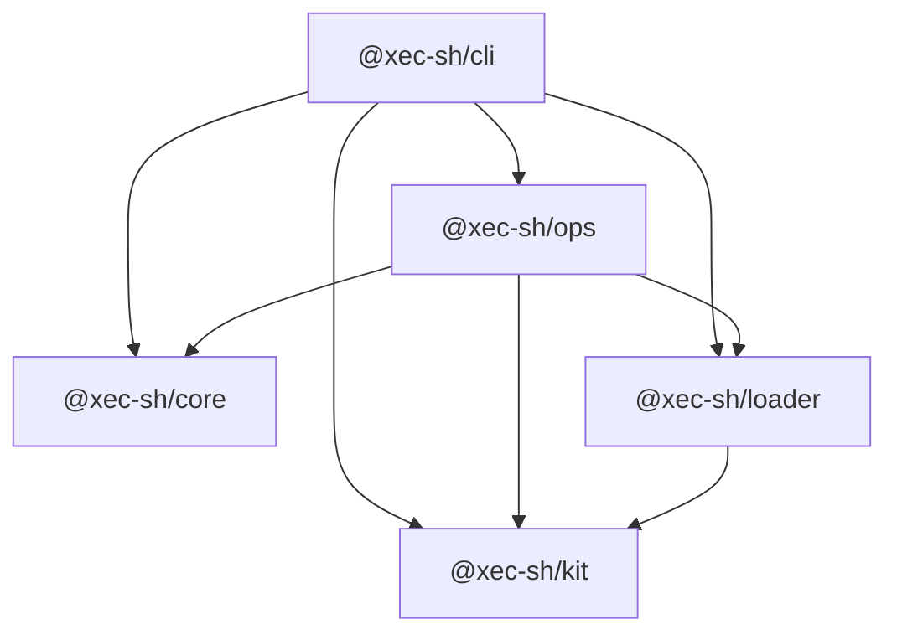
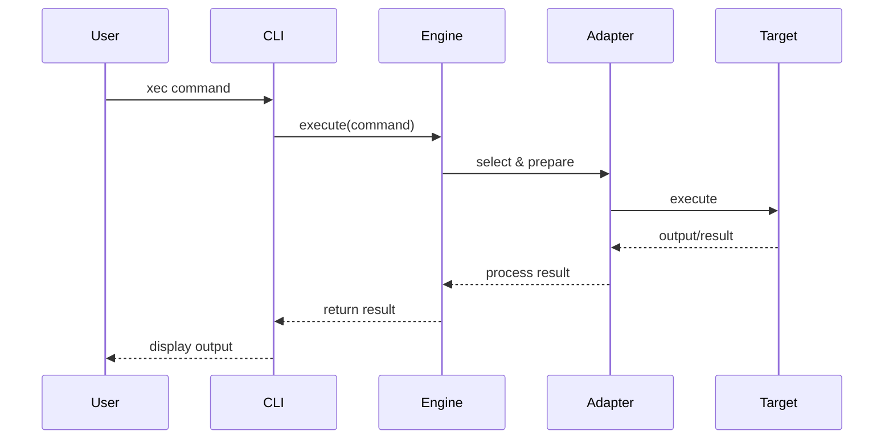
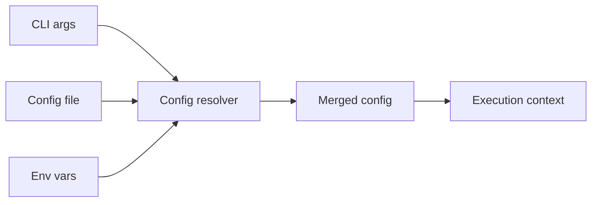
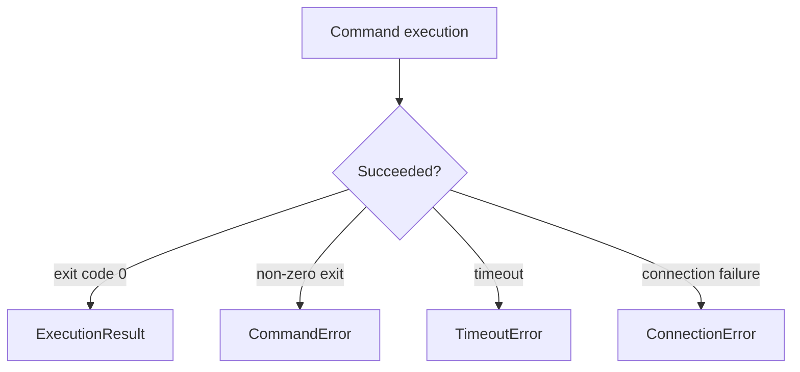

# Architecture

## System Overview

Xec is designed as a modular, extensible system for universal command execution across multiple environments. The architecture emphasizes separation of concerns, type safety, and performance.

## Monorepo Structure

Xec uses a monorepo architecture managed by Turborepo:

```
xec/
├── apps/
│   └── xec/              # CLI application (@xec-sh/cli) — thin wrapper
├── packages/
│   ├── core/             # Shell execution engine (@xec-sh/core)
│   ├── ops/              # DevOps operations library (@xec-sh/ops)
│   ├── kit/              # TUI/CLI components (@xec-sh/kit)
│   ├── loader/           # Script loading & modules (@xec-sh/loader)
│   └── testing/          # Shared test utilities (@xec-sh/testing)
├── website/              # Documentation site (Docusaurus)
└── turbo.json            # Build orchestration
```

### Package Dependencies

Arrows point from each package to the packages it imports at runtime. `@xec-sh/testing` is not shown — it does not depend on other Xec packages and is consumed by Vitest suites through its required runner peer.



## Core Components

### 1. Execution Engine

The execution engine (`packages/core/src/core/execution-engine.ts`) is the central component that:

- Parses command templates
- Selects appropriate adapters
- Manages execution lifecycle
- Handles streaming and buffering
- Provides error handling

```typescript
import { ExecutionEngine } from '@xec-sh/core';

const engine = new ExecutionEngine();
try {
  const result = await engine.execute({ command: 'printf ready' });
  console.log(result.stdout);
} finally {
  await engine.dispose();
}
```

### 2. Adapter System

Adapters (`packages/core/src/adapters/`) provide environment-specific implementations:

#### Base Adapter Interface

```typescript
import type { LocalAdapter } from '@xec-sh/core';

// Inspect the real adapter contract rather than copying a second interface.
type ExecuteCommand = Parameters<LocalAdapter['execute']>[0];
type ExecuteResult = Awaited<ReturnType<LocalAdapter['execute']>>;
```

#### Adapter Implementations

- **LocalAdapter**: Native process execution
- **SSHAdapter**: Remote execution via SSH
- **DockerAdapter**: Container execution via Docker API
- **KubernetesAdapter**: Pod execution via kubectl

### 3. Command Builder

The engine parses tagged templates, escapes their interpolated values and passes a `Command` to the chosen adapter. String shell syntax stays explicit; values are not shell programs:

```typescript
import { $ } from '@xec-sh/core';

const filename = 'report with spaces.txt';
await $`printf '%s\n' ${filename}`;
```

### 4. Connection Management

#### Connection Pool

```typescript
import { $ } from '@xec-sh/core';

const target = $.ssh('deploy@server.example.com');
try {
  await target`uptime`;
  await target`df -h`;
} finally {
  await $.dispose();
}
```

#### SSH Connection Pool

- Maintains persistent SSH connections
- Configurable pool size and idle timeout
- Dead connections are discarded; uncertain remote outcomes are not silently replayed
- Connection health checks

### 5. CLI Layer

The CLI (`apps/xec/src/`) provides:

- Command parsing and routing
- Configuration loading
- Script execution
- Task management
- Interactive features

```bash
xec run scripts/inspect.ts
xec on deploy@server.example.com 'uptime'
xec in app 'node --version'
```

## Data Flow

### Command Execution Flow

A command travels from the CLI through the engine to the selected adapter, and the result flows back the same way:



### Configuration Loading

Configuration is merged from three sources before execution starts:



## Template Literal Processing

### Parse Phase

```typescript
import { $ } from '@xec-sh/core';

const value = 'one argument; not another command';
await $`printf '%s\n' ${value}`;
```

### Compilation Phase

```typescript
import { ExecutionEngine, type Command } from '@xec-sh/core';

const command: Command = {
  command: process.execPath,
  args: ['-e', 'console.log("ready")'],
  shell: false,
};
const engine = new ExecutionEngine();
try { console.log((await engine.execute(command)).stdout); }
finally { await engine.dispose(); }
```

## Error Architecture

### Error Hierarchy

Execution failures use the exported error classes in `packages/core/src/core/error.ts`. Input and application errors may also be ordinary JavaScript errors. Use the real classes and stable `code`/`kind` fields:

```typescript
import { $, CommandError, ExecutionError } from '@xec-sh/core';

try { await $`exit 7`; }
catch (error) {
  if (error instanceof CommandError) console.error(error.exitCode);
  else if (error instanceof ExecutionError) console.error(error.code, error.kind);
  else throw error;
}
```

### Error Flow

A failed execution surfaces as the subclass matching what went wrong:



## Performance Optimizations

### 1. Connection Pooling

- **SSH**: Reuse SSH connections across commands
- **Docker**: Maintain Docker client connections
- **Kubernetes**: Preserve the explicitly selected context and kubeconfig for every operation

### 2. Lazy Loading

```typescript
// A project can load a library only when the operation needs it.
const { Pipeline } = await import('@xec-sh/ops/pipeline');
const plan = Pipeline.create('inspect').step('version', { run: 'node --version' });
const result = await plan.run();
if (!result.success) throw new Error('Inspection failed');
```

### 3. Stream Processing

```typescript
import { $ } from '@xec-sh/core';

for await (const line of $`printf 'one\ntwo\n'`) {
  console.log(line);
}
```

### 4. Parallel Execution

```typescript
import { $ } from '@xec-sh/core';

const results = await $.parallel.all([
  $`node --version`,
  $`git --version`,
], { maxConcurrency: 2 });
console.log(results.map(result => result.exitCode));
```

## Security Architecture

### 1. Input Sanitization

```typescript
import { $ } from '@xec-sh/core';

const untrustedFilename = 'file; echo not-a-command';
await $`printf '%s\n' ${untrustedFilename}`;
// $.raw deliberately disables interpolation escaping. Use it only with trusted shell text.
```

### 2. Secret Management

```typescript
import { ConfigurationManager } from '@xec-sh/ops';

const project = new ConfigurationManager();
await project.load();
const secrets = project.getSecretManager();

const apiToken = await secrets.get('API_TOKEN');
if (!apiToken) throw new Error('API_TOKEN is not configured');
// Pass it to the intended authenticated operation; do not print it.
```

### 3. Permission Model

Xec runs with the privileges of its local process and configured remote identity.
It is not an operating-system sandbox. Use restricted service identities and target
credentials, and enable only the adapters and operations your application requires.
Command escaping and diagnostic redaction do not replace authorization.

## Extension Points

### 1. Custom Adapters

Adapter implementations follow the internal `BaseAdapter` contract and the
engine registry. This is a Core contribution, not a separate public plugin API. The [adapter development guide](../core/execution-engine/adapters/concept.md)
describes validation, streaming, errors and disposal. Do not copy an abbreviated
interface from documentation into a separate execution mechanism.

### 2. Command Hooks

Use the engine's declared hooks and event types for observation. Keep telemetry
separate from executable input and preserve error propagation and cancellation.
The [execution-engine reference](../api/execution-engine.md) documents the public surface.

### 3. Plugin System

The CLI discovers project commands from `.xec/commands`; libraries compose through
ordinary imports and functions. There is no separate public `Plugin.install(xec)`
contract. See [creating commands](../commands/custom/creating-commands.md).

## Testing Architecture

### Unit Testing

```typescript
import { expect, it } from 'vitest';
import { $ } from '@xec-sh/core';

it('retains the command exit code', async () => {
  const result = await $`${process.execPath} -e ${'process.exitCode = 7'}`.nothrow();
  expect(result.exitCode).toBe(7);
});
```

### Integration Testing

```typescript
import { expect, it } from 'vitest';
import { $ } from '@xec-sh/core';
import { describeSSH, getSSHConfig } from '@xec-sh/testing';

describeSSH('SSH output', () => {
  it('preserves output from the fixture', async () => {
    const target = $.ssh(getSSHConfig('alpine-apk'));
    expect(await target`printf ready`.text()).toBe('ready');
  });
}, { containers: ['alpine-apk'], skipIfNoDocker: true });
```

### Test Utilities

`@xec-sh/testing` provides named SSH/Docker fixtures, a Kind cluster manager,
binary discovery and shell-name validation. It requires the declared Vitest runner;
fixture skips must remain visible in test results.

## Build System

### Turborepo Pipeline

```json
{
  "tasks": {
    "build": {
      "dependsOn": ["^build"],
      "outputs": ["dist/**"]
    },
    "test": {
      "dependsOn": ["build"],
      "outputs": []
    },
    "lint": {
      "outputs": []
    }
  }
}
```

### TypeScript Configuration

```json
{
  "compilerOptions": {
    "target": "ES2022",
    "module": "NodeNext",
    "moduleResolution": "NodeNext",
    "strict": true,
    "esModuleInterop": true,
    "skipLibCheck": true,
    "forceConsistentCasingInFileNames": true
  }
}
```

## Deployment Architecture

### Package Publishing

The repository's dynamic release recipe separates preparation from publication:


Publication reuses the prepared bytes. It does not rebuild packages or repeat the
full test suite for each upload. See [Verified package releases](../ops/release.md)
for prerequisites, cancellation, authentication and recovery.

### Distribution Channels

npm distributes the six public workspace packages. GitHub Releases records the
verified tag, release notes and package inventory; the current recipe does not
publish standalone binaries, Docker images or a Homebrew formula.

## Future Architecture

### Planned Enhancements

The documentation website is planned to migrate from Docusaurus to Lumen after
the current release. That work must preserve routes, examples and link validation;
it is not a prerequisite for releasing Xec. Task dependencies, pipelines and
workflow orchestration already exist in [Ops](../ops/index.md), so DAG execution
is an existing capability, not a promised future subsystem.

## Summary

Xec's architecture is designed for:

- **Modularity**: Clear separation of concerns
- **Extensibility**: Easy to add new adapters and features
- **Performance**: Optimized for speed and efficiency
- **Type Safety**: Full TypeScript throughout
- **Testability**: Comprehensive testing at all levels
- **Security**: Built-in security measures

This architecture enables Xec to provide a unified, powerful interface for command execution across any environment while maintaining simplicity and performance.

## Related Documentation

- [Core Concepts](./core-concepts.md) - Fundamental concepts
- [Execution Engine](../core/execution-engine/overview.md) - Engine details
- [Adapter Development](../core/execution-engine/adapters/concept.md) - Creating adapters
- [Performance](../core/execution-engine/performance/optimization.md) - Performance guide