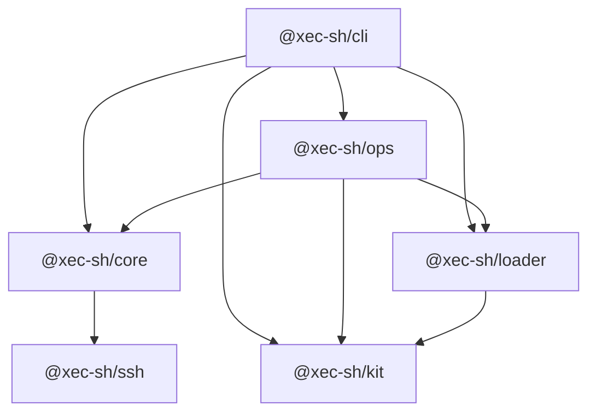
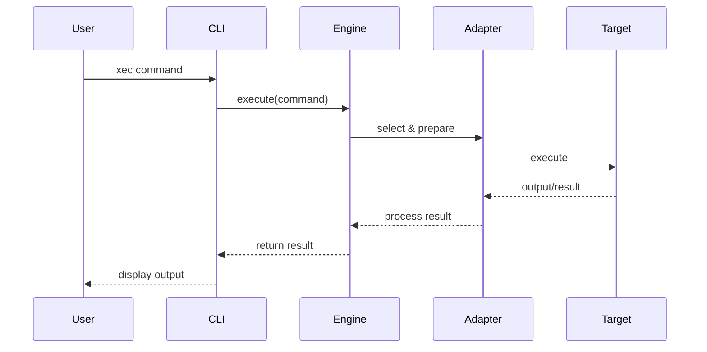
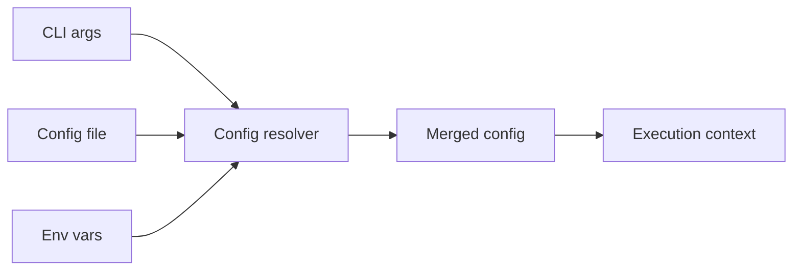
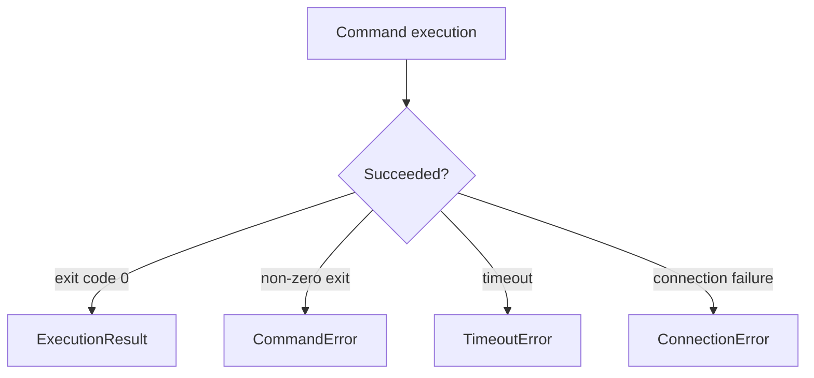

# Architecture {#architecture}

## System Overview {#system-overview}

Xec has three entry points for the same execution model: the CLI for direct
operations, TypeScript scripts and library calls for programmatic control, and
project tasks for repeatable workflows. Core owns command execution; Ops owns
operation composition. The CLI adds parsing, configuration and interaction
without creating a separate execution engine.

This page describes the repository architecture. Installed versions expose only
their published API; an unreleased source change is not available merely because
its documentation has changed. [When to use Xec](./when-to-use.md) explains the
choice between the entry points and their boundaries.

## Monorepo Structure {#monorepo-structure}

Published Xec commands manage the repository workflow; Turborepo manages the workspace build graph and cache:

:::filetree{title="xec/"}
- `apps/`
  - `xec/` — CLI application (@xec-sh/cli) — thin wrapper
- `packages/`
  - `core/` — Shell execution engine (@xec-sh/core)
  - `ssh/` — SSH protocol, trust and connection ownership (@xec-sh/ssh)
  - `ops/` — DevOps operations library (@xec-sh/ops)
  - `kit/` — TUI/CLI components (@xec-sh/kit)
  - `loader/` — Script loading & modules (@xec-sh/loader)
  - `testing/` — Shared test utilities (@xec-sh/testing)
- `.xec/`
  - `commands/` — Native project commands and their argument schemas
  - `lib/` — Shared repository command implementation
  - `config.yaml` — Project workflows
- `website/` — Lumen + Prism documentation site
- `turbo.json` — Workspace task graph and cache
:::
### Package Dependencies {#package-dependencies}

Arrows point from each package to the packages it imports at runtime. `@xec-sh/testing` is not shown — it does not depend on other Xec packages and is consumed by Vitest suites through its required runner peer.



## Core Components {#core-components}

### 1. Execution Engine {#1-execution-engine}

The execution engine (`packages/core/src/core/execution-engine.ts`) is the central component that:

- Parses command templates
- Selects appropriate adapters
- Manages execution lifecycle
- Handles streaming and buffering
- Provides error handling

```typescript
import { ExecutionEngine } from '@xec-sh/core';

const engine = new ExecutionEngine();
try {
  const result = await engine.execute({ command: 'printf ready' });
  console.log(result.stdout);
} finally {
  await engine.dispose();
}
```

### 2. Adapter System {#2-adapter-system}

Adapters (`packages/core/src/adapters/`) provide environment-specific implementations:

#### Base Adapter Interface {#base-adapter-interface}

```typescript
import type { LocalAdapter } from '@xec-sh/core';

// Inspect the real adapter contract rather than copying a second interface.
type ExecuteCommand = Parameters<LocalAdapter['execute']>[0];
type ExecuteResult = Awaited<ReturnType<LocalAdapter['execute']>>;
```

#### Adapter Implementations {#adapter-implementations}

- **LocalAdapter**: Native process execution
- **SSHAdapter**: Remote execution via SSH
- **DockerAdapter**: Container execution via Docker API
- **KubernetesAdapter**: Pod execution via kubectl

### 3. Command Builder {#3-command-builder}

The engine parses tagged templates, escapes their interpolated values and passes a `Command` to the chosen adapter. String shell syntax stays explicit; values are not shell programs:

```typescript
import { $ } from '@xec-sh/core';

const filename = 'report with spaces.txt';
await $`printf '%s\n' ${filename}`;
```

### 4. Connection Management {#4-connection-management}

#### Connection Pool {#connection-pool}

```typescript
import { $ } from '@xec-sh/core';

const target = $.ssh('deploy@server.example.com');
try {
  await target`uptime`;
  await target`df -h`;
} finally {
  await $.dispose();
}
```

#### SSH Connection Pool {#ssh-connection-pool}

In the published 0.13.0 architecture, @xec-sh/ssh owns this pool. Core owns
command policy and result mapping, with no second connection registry. See
[connections and failures](../ssh/connections.md).

- Maintains persistent SSH connections
- Configurable pool size and idle timeout
- Dead connections are discarded; uncertain remote outcomes are not silently replayed
- Connection health checks

### 5. CLI Layer {#5-cli-layer}

The CLI (`apps/xec/src/`) provides:

- Command parsing and routing
- Configuration loading
- Script execution
- Task management
- Interactive features

```bash
xec run scripts/inspect.ts
xec on deploy@server.example.com 'uptime'
xec in app 'node --version'
```

## Data Flow {#data-flow}

### Command Execution Flow {#command-execution-flow}

A command travels from the CLI through the engine to the selected adapter, and the result flows back the same way:



### Configuration Loading {#configuration-loading}

Configuration is merged from three sources before execution starts:



## Template Literal Processing {#template-literal-processing}

### Parse Phase {#parse-phase}

```typescript
import { $ } from '@xec-sh/core';

const value = 'one argument; not another command';
await $`printf '%s\n' ${value}`;
```

### Compilation Phase {#compilation-phase}

```typescript
import { ExecutionEngine, type Command } from '@xec-sh/core';

const command: Command = {
  command: process.execPath,
  args: ['-e', 'console.log("ready")'],
  shell: false,
};
const engine = new ExecutionEngine();
try { console.log((await engine.execute(command)).stdout); }
finally { await engine.dispose(); }
```

## Error Architecture {#error-architecture}

### Error Hierarchy {#error-hierarchy}

Execution failures use the exported error classes in `packages/core/src/core/error.ts`. Input and application errors may also be ordinary JavaScript errors. Use the real classes and stable `code`/`kind` fields:

```typescript
import { $, CommandError, ExecutionError } from '@xec-sh/core';

try { await $`exit 7`; }
catch (error) {
  if (error instanceof CommandError) console.error(error.exitCode);
  else if (error instanceof ExecutionError) console.error(error.code, error.kind);
  else throw error;
}
```

### Error Flow {#error-flow}

A failed execution surfaces as the subclass matching what went wrong:



## Performance Optimizations {#performance-optimizations}

### 1. Connection Pooling {#1-connection-pooling}

- **SSH**: Reuse SSH connections across commands
- **Docker**: Maintain Docker client connections
- **Kubernetes**: Preserve the explicitly selected context and kubeconfig for every operation

### 2. Lazy Loading {#2-lazy-loading}

```typescript
// A project can load a library only when the operation needs it.
const { Pipeline } = await import('@xec-sh/ops/pipeline');
const plan = Pipeline.create('inspect').step('version', { run: 'node --version' });
const result = await plan.run();
if (!result.success) throw new Error('Inspection failed');
```

### 3. Stream Processing {#3-stream-processing}

```typescript
import { $ } from '@xec-sh/core';

for await (const line of $`printf 'one\ntwo\n'`) {
  console.log(line);
}
```

### 4. Parallel Execution {#4-parallel-execution}

```typescript
import { $ } from '@xec-sh/core';

const results = await $.parallel.all([
  $`node --version`,
  $`git --version`,
], { maxConcurrency: 2 });
console.log(results.map(result => result.exitCode));
```

## Security Architecture {#security-architecture}

### 1. Input Sanitization {#1-input-sanitization}

```typescript
import { $ } from '@xec-sh/core';

const untrustedFilename = 'file; echo not-a-command';
await $`printf '%s\n' ${untrustedFilename}`;
// $.raw deliberately disables interpolation escaping. Use it only with trusted shell text.
```

### 2. Secret Management {#2-secret-management}

```typescript
import { ConfigurationManager } from '@xec-sh/ops';

const project = new ConfigurationManager();
await project.load();
const secrets = project.getSecretManager();

const apiToken = await secrets.get('API_TOKEN');
if (!apiToken) throw new Error('API_TOKEN is not configured');
// Pass it to the intended authenticated operation; do not print it.
```

### 3. Permission Model {#3-permission-model}

Xec runs with the privileges of its local process and configured remote identity.
It is not an operating-system sandbox. Use restricted service identities and target
credentials, and enable only the adapters and operations your application requires.
Command escaping and diagnostic redaction do not replace authorization.

## Extension Points {#extension-points}

### 1. Custom Adapters {#1-custom-adapters}

Adapter implementations follow the internal `BaseAdapter` contract and the
engine registry. This is a Core contribution, not a separate public plugin API. The [adapter development guide](../core/execution-engine/adapters/concept.md)
describes validation, streaming, errors and disposal. Do not copy an abbreviated
interface from documentation into a separate execution mechanism.

### 2. Command Hooks {#2-command-hooks}

Use the engine's declared hooks and event types for observation. Keep telemetry
separate from executable input and preserve error propagation and cancellation.
The [execution-engine reference](../api/execution-engine.md) documents the public surface.

### 3. Plugin System {#3-plugin-system}

The CLI discovers project commands from `.xec/commands`; libraries compose through
ordinary imports and functions. There is no separate public `Plugin.install(xec)`
contract. See [creating commands](../commands/custom/creating-commands.md).

## Testing Architecture {#testing-architecture}

### Unit Testing {#unit-testing}

```typescript
import { expect, it } from 'vitest';
import { $ } from '@xec-sh/core';

it('retains the command exit code', async () => {
  const result = await $`${process.execPath} -e ${'process.exitCode = 7'}`.nothrow();
  expect(result.exitCode).toBe(7);
});
```

### Integration Testing {#integration-testing}

```typescript
import { expect, it } from 'vitest';
import { $ } from '@xec-sh/core';
import { describeSSH, getSSHConfig } from '@xec-sh/testing';

describeSSH('SSH output', () => {
  it('preserves output from the fixture', async () => {
    const target = $.ssh(getSSHConfig('alpine-apk'));
    expect(await target`printf ready`.text()).toBe('ready');
  });
}, { containers: ['alpine-apk'], skipIfNoDocker: true });
```

### Test Utilities {#test-utilities}

`@xec-sh/testing` provides named SSH/Docker fixtures, a Kind cluster manager,
binary discovery and shell-name validation. It requires the declared Vitest runner;
fixture skips must remain visible in test results.

## Build System {#build-system}

### Turborepo Pipeline {#turborepo-pipeline}

The repository uses the pinned, published Xec CLI to run project tasks from
`.xec/config.yaml`. Xec owns the workflow and release policy; Turbo owns the
workspace dependency graph, build ordering and task cache. `pnpm build` invokes
`xec run build`, which runs `turbo run build --filter=@xec-sh/cli`. This selects
the CLI and its prerequisite builds. `pnpm build:full` builds all workspaces.

Builds depend on their workspace dependencies' builds. Type checks wait for those
built public declarations, then reuse Turbo's task cache. The shared TypeScript
configuration and compiler launchers are explicit global cache inputs: changing
how a package compiles invalidates the affected cached results. Repository
commands have a separate type check in `.xec/tsconfig.json` and are linted with
the package sources.

Each package script calls the published driver from the repository root:
`pnpm --dir ../.. exec xec package build packages/core`, for example. The common
Ops pipeline validates the compiler configuration, emits to a private sibling
of `dist`, optionally bundles Kit with Bun, and checks the output before replacing
`dist`. It preserves source-map paths and excludes compiler cache files from the
artifact. `xec package clean` removes only that package's generated `dist`.
Both operations acquire the same per-package lock as release preparation.

Compilation failures leave the previous artifact intact. A failed installation
restores it when the filesystem confirms that recovery; failed recovery retains
the old and new directories and ownership lock for inspection. This two-rename
publication is not a crash-atomic filesystem transaction: process death between
renames requires reconciliation of those exact paths. Cleanup errors preserve
the original failure instead of masking it.

A Turbo cache hit is a reusable task result, not release acceptance. The release
API separately checks source identity, archive bytes and consumer contracts
before publication. Native integration checks still require their actual runtime
and external fixtures. They cannot be replaced by a previously cached unit result.

### TypeScript Configuration {#typescript-configuration}

Builds and type checks use **TypeScript 7** through the declared
`@typescript/native` alias. Its `tsc` executable is selected by package scripts
and the shared compiler launcher. The `typescript` import is separately bound
to the TypeScript 6 JavaScript Compiler API for tools that inspect source ASTs;
it does not select the build compiler.

The root `tsconfig.json` supplies strict checking and NodeNext module semantics.
Package configurations declare their own source/output boundaries. JavaScript
emission and declaration generation are part of the package build; `typecheck`
uses `--noEmit`. The exact installed versions come from the frozen lockfile.

Changing an orchestrator does not make the compiler faster. Evaluate end-to-end
build speed with the same source, compiler, machine and cache state, including
the unchanged-build and single-package-change cases. Keep the graph/cache owner
explicit instead of adding a second build scheduler inside a project command.

## Deployment Architecture {#deployment-architecture}

### Package Publishing {#package-publishing}

The repository's dynamic release recipe separates preparation from publication:


Publication reuses the prepared bytes. It does not rebuild packages or repeat the
full test suite for each upload. See [Verified package releases](../ops/release.md)
for prerequisites, cancellation, authentication and recovery.

### Distribution Channels {#distribution-channels}

npm distributes the public workspace packages, including the owned SSH client
introduced for 0.13.0. GitHub Releases records the
verified tag, release notes and package inventory; the current recipe does not
publish standalone binaries, Docker images or a Homebrew formula.

## Documentation architecture {#future-architecture}

### Lumen and Prism {#planned-enhancements}

The website is built with the published Lumen and Prism packages pinned in `website/package.json`. Lumen owns Markdown compilation, code highlighting, corpus link checks, search indexing and selective React hydration. Prism provides the shared theme, controls and accessible interaction primitives.

Xec runs the site build and verifies the public route/anchor contract. The
homepage examples come from one source inventory, shared by server rendering,
interactive tabs, copy actions and the documentation compiler check. The native
`xec docs check` command compiles examples against built workspace public
exports; it does not execute them or substitute API stubs. Browser tests verify
the generated pages. [Contributing](https://github.com/xec-sh/xec/blob/main/CONTRIBUTING.md)
describes the scoped checks and the distinction between the published driver
and candidate workspace declarations.

Task dependencies, pipelines and workflow orchestration are existing [Ops](../ops/index.md) capabilities; the website does not implement a separate task engine.

## Architectural responsibilities {#summary}

Keep each guarantee with its owner. Core preserves execution identity, result,
stream and lifecycle semantics. Ops composes those capabilities into operations
with explicit failure and recovery policy. The CLI exposes those operations to
people and agents with native argument validation. Documentation and tests must
exercise the same public path; a reported success must describe an observed
outcome, not a skipped or unimplemented operation.


## See also {#related-documentation}

- [Core concepts](./core-concepts.md).
- [Execution engine](../core/execution-engine/overview.md).
- [Adapter development](../core/execution-engine/adapters/concept.md).
- [Performance and optimization](../core/execution-engine/performance/optimization.md).
