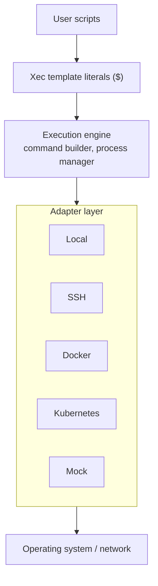

# Core Concepts

Understanding Xec's core concepts will help you leverage its full power for multi-environment command execution.

## Execution Engine

The execution engine is the heart of Xec, providing a unified API that abstracts away environment differences while preserving full control.

### Key Characteristics

- **Universal API**: Single interface for all environments
- **Async-First**: Built on promises and async/await
- **Streaming Support**: Real-time output streaming
- **Error Handling**: Consistent error patterns across environments

### How It Works

```typescript
import { $ } from '@xec-sh/core';

// The $ function creates an execution context
const result = await $`echo "Hello, World"`;

// The same API works everywhere
await $.ssh('deploy@server')`echo "Hello from SSH"`;
await $.docker({ container: 'container' })`echo "Hello from Docker"`;
await $.k8s({ pod: 'pod' })`echo "Hello from Kubernetes"`;
```

## Adapters

Adapters are environment-specific implementations that handle the details of execution while maintaining a consistent interface.

### Adapter Types

#### Local Adapter
Executes commands on the local machine.

```typescript
// Direct local execution
await $`npm install`;
```

#### SSH Adapter
Executes commands on remote servers via SSH.

```typescript
// SSH with connection pooling
await $.ssh({
  host: 'server.example.com',
  username: 'deploy'
})`systemctl restart app`;
```

#### Docker Adapter
Executes commands inside Docker containers.

```typescript
// Docker container execution
await $.docker({ container: 'my-app' })`python manage.py migrate`;
```

#### Kubernetes Adapter
Executes commands in Kubernetes pods.

```typescript
// Kubernetes pod execution
await $.k8s({
  pod: 'app-pod',
  namespace: 'production'
})`./health-check.sh`;
```

### Adapter Selection

Xec automatically selects the appropriate adapter based on the target:

```typescript
import { targets } from '@xec-sh/ops';

// Resolve a configured reference through the public configuration API.
await targets.exec('hosts.production', './deploy.sh');
```

## Configuration System

Xec uses a hierarchical configuration system centered around `.xec/config.yaml`.

### Configuration Structure

```yaml
# .xec/config.yaml
name: my-project
version: 1.0.0

# Global defaults
defaults:
  timeout: 30000
  shell: /bin/bash
  env:
    NODE_ENV: production

# Named execution targets
targets:
  hosts:
    staging:
      type: ssh
      host: staging.example.com
      user: deploy
      privateKey: ~/.ssh/deploy_key
    production:
      type: ssh
      host: prod.example.com
      user: deploy
      
  containers:
    app:
      type: docker
      container: my-app
      
  pods:
    web:
      type: kubernetes
      pod: web-pod
      namespace: default

# Reusable tasks
tasks:
  deploy:
    description: Deploy application
    command: ./scripts/deploy.sh
    targets: [hosts.staging, hosts.production]
    
  test:
    command: npm test
    targets: [local]

# Environment profiles
profiles:
  development:
    defaults:
      env:
        NODE_ENV: development
  production:
    defaults:
      env:
        NODE_ENV: production
```

### How Configuration Works

1. **Targets** define where commands run (SSH hosts, Docker containers, K8s pods)
2. **Tasks** are reusable command sequences with parameters
3. **Profiles** switch between different configurations (dev/staging/prod)
4. **Defaults** apply globally unless overridden

## Targets

Targets are named execution contexts that define where and how commands should run.

### Target Types

```yaml
targets:
  # Local execution
  local:
    type: local
    
  # SSH targets
  hosts:
    web-server:
      type: ssh
      host: web.example.com
      user: deploy
      privateKey: ~/.ssh/id_rsa
      port: 22
    
  # Docker targets
  containers:
    app:
      type: docker
      container: my-app  # Existing container
      
    ephemeral:
      type: docker
      image: node:20  # Create new container
      autoRemove: true
    
  # Kubernetes targets
  pods:
    api:
      type: kubernetes
      pod: api-pod
      namespace: production
      container: main  # Optional: specific container in pod
```

### Target Resolution

```typescript
import { targets } from '@xec-sh/ops';

await targets.exec('hosts.web-server', 'uptime');
await targets.exec('containers.app', 'npm test');
await targets.exec('pods.api', './health-check');

const reference = process.env.DEPLOY_TARGET || 'hosts.staging';
await targets.exec(reference, './deploy.sh');

const results = await Promise.all(
  ['hosts.staging', 'hosts.production'].map(ref => targets.exec(ref, './health-check.sh'))
);
```

## Template Literals

Xec uses JavaScript's template literal syntax for natural command composition.

### Basic Usage

```typescript
// Simple command
await $`ls -la`;

// With variables
const file = 'app.js';
await $`node ${file}`;

// Multi-line commands
await $`
  cd /app
  npm install
  npm run build
`;
```

### Advanced Features

```typescript
// Command chaining
await $`npm install`.pipe($`npm run build`);

// Output capture
const status = await $`git status`.text();
console.log(status);

// Error handling
const result = await $`test-command`.nothrow();
if (!result.ok) {
  console.error('Command failed:', result.cause);
}
```

## Process Promise

Commands in Xec return a ProcessPromise - an enhanced promise with additional methods.

### Methods

```typescript
const promise = $`long-running-command`;

// Pipe output to another command
promise.pipe($`grep pattern`);

// Suppress errors
promise.nothrow();

// Set timeout
promise.timeout(5000);

// Kill the process
promise.kill();

// Get stdout/stderr
const result = await promise;
console.log(result.stdout, result.stderr);
```

## Connection Pooling

Xec automatically manages connection pools for efficient resource usage.

### SSH Connection Pooling

```typescript
import { $ } from '@xec-sh/core';

const servers = ['web-1', 'web-2'];
for (const host of servers) {
  await $.ssh({ host, username: 'deploy' })`uptime`;
}

// Reuse the engine throughout the owning operation; dispose it when finished.
await $.dispose();
```

### Benefits

- **Performance**: Reuse existing connections
- **Resource Efficiency**: Limit concurrent connections
- **Automatic Cleanup**: Idle connections are closed
- **Transparent**: Works without configuration

## Error Handling

Xec provides consistent error handling across all environments.

### Error Types

```typescript
import { CommandError, ConnectionError, TimeoutError } from '@xec-sh/core';

// Execution errors
try {
  await $`false`;
} catch (error) {
  if (error instanceof CommandError) {
    console.log('Exit code:', error.exitCode);
  }
}

// Connection errors
try {
  await $.ssh('unreachable')`echo test`;
} catch (error) {
  if (error instanceof ConnectionError) {
    console.log('Connection failed:', error.message);
  }
}

// Timeout errors
try {
  await $`sleep 100`.timeout(1000);
} catch (error) {
  if (error instanceof TimeoutError) {
    console.log('Command timed out');
  }
}
```

### Result Pattern

```typescript
// Use nothrow() for safe execution
const result = await $`risky-command`.nothrow();

if (result.ok) {
  console.log('Success:', result.stdout);
} else {
  console.log('Failed:', result.cause);
}
```

## Streaming

Xec supports real-time output streaming for long-running commands.

### Stream Processing

```typescript
// Stream output line by line
for await (const line of $`tail -f /var/log/app.log`) {
  console.log('Log:', line);
}

// Stream to multiple destinations
await $`build-command`
  .pipe(process.stdout)
  .pipe(fs.createWriteStream('build.log'));
```

## Parallel Execution

Execute commands across multiple targets simultaneously.

### Parallel Patterns

```typescript
// Independent local commands run concurrently.
const [build, test] = await $.parallel.all([
  $`npm run build`,
  $`npm test`,
], { maxConcurrency: 2 });

const servers = ['web-1', 'web-2', 'web-3'];
const results = await $.parallel.all(
  servers.map(host => $.ssh({ host, username: 'deploy' })`./health-check.sh`),
  { maxConcurrency: 2 },
);
```

## Configuration Context

Xec commands have access to configuration context.

### Context Variables

```typescript
import { config } from '@xec-sh/ops';

// In an Xec CLI script, this metadata describes the selected target.
console.log($targetInfo.type);
await config.load();
console.log(config.get('name'));
console.log(process.env.NODE_ENV);
```

## File Operations

Xec provides unified file operations across environments.

### Cross-Environment Files

```typescript
// Use the CLI for file operations
// xec copy local-file.txt server:/remote/path/
// xec copy server:/remote/file.txt local-path/

// Or use the transfer engine from code. `upload`/`download` resolve the remote
// side from the engine's own target, so there is no URL to restate the host in.
const ssh = $.ssh('deploy@server');

// Upload a local file to the target
await ssh.uploadFile('local-file.txt', '/remote/path/local-file.txt');

// Download from the target to a local path
await ssh.downloadFile('/remote/file.txt', './file.txt');
```

## Module System

Xec supports modular command organization.

### Command Modules

```typescript
import type { ProcessPromise } from '@xec-sh/core';

type CommandTarget = (parts: TemplateStringsArray, ...values: unknown[]) => ProcessPromise;

export async function deploy(target: CommandTarget, version: string) {
  await target`./deploy.sh ${version}`;
}

await deploy($.ssh('deploy@production'), 'v1.2.3');
```

## Best Practices

### 1. Use Named Targets

```typescript
import { targets } from '@xec-sh/ops';

// Read identity, connection settings and environment from project configuration.
await targets.exec('hosts.production', './deploy.sh');
```

### 2. Handle Errors Gracefully

```typescript
// Good: Explicit error handling
const result = await $`risky-command`.nothrow();
if (!result.ok) {
  // Handle error
}

// Avoid: Unhandled promise rejections
await $`risky-command`;  // May crash
```

### 3. Use Connection Pooling

```typescript
// Good: Reuse connections
const ssh = $.ssh('deploy@server');
await ssh`command1`;
await ssh`command2`;

// Also good: Pooling handles this automatically
await $.ssh('deploy@server')`command1`;
await $.ssh('deploy@server')`command2`;  // Reuses pooled connection
```

### 4. Stream Large Outputs

```typescript
// Good: Stream processing
for await (const line of $`large-output`) {
  console.log(line);
}

// Avoid: Loading everything in memory
const result = await $`large-output`;
console.log(result.stdout);  // May cause OOM
```

## Architecture Overview

A command written as a template literal passes through the execution engine to an adapter, which runs it on the target environment:



## Summary

These core concepts form the foundation of Xec:

- **Execution Engine**: Unified API for all environments
- **Adapters**: Environment-specific implementations
- **Targets**: Named execution contexts
- **Template Literals**: Natural command syntax
- **Process Promise**: Enhanced promise with methods
- **Connection Pooling**: Efficient resource management
- **Error Handling**: Consistent error patterns
- **Streaming**: Real-time output processing
- **Parallel Execution**: Multi-target command execution

Understanding these concepts enables you to:
- Write portable scripts that work everywhere
- Handle errors consistently
- Optimize performance with pooling and streaming
- Build complex automation workflows

## Next Steps

- [Architecture Deep Dive](./architecture.md) - Technical architecture details
- [Execution Engine](../core/execution-engine/overview.md) - Engine implementation
- [Writing Scripts](../scripting/basics/first-script.md) - Start scripting
- [Configuration](../configuration/overview.md) - Configure your environment