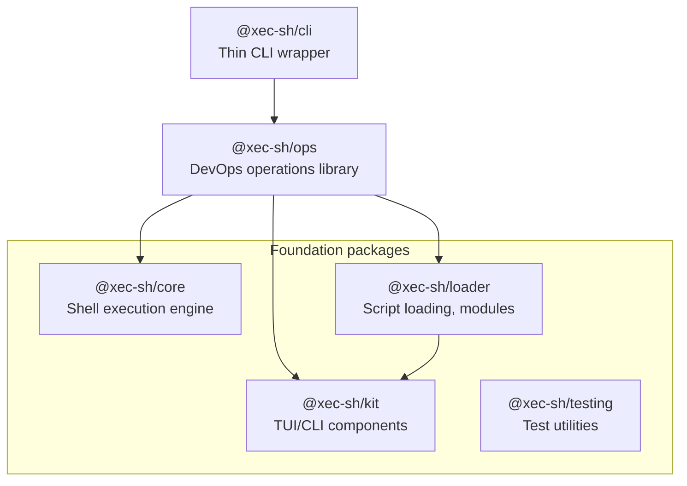

# The Xec Ecosystem {#the-xec-ecosystem}

Xec is an ecosystem of 6 packages providing a complete DevOps automation platform — from shell execution to deployment pipelines.

## Architecture {#architecture}

The packages form layers: a thin CLI on top of the operations library, which builds on the execution engine and the other foundation packages. Arrows point from each package to what it depends on; `@xec-sh/testing` stands alone — it is used only by test suites.



## Packages {#packages}

### @xec-sh/core {#xec-shcore}
The shell execution engine. Use it to run commands locally, over SSH, in Docker containers, or on Kubernetes pods.

```bash
pnpm add @xec-sh/core
```

```typescript
import { $, configure } from '@xec-sh/core';

// Local execution
const result = await $`echo "Hello, world!"`;

// SSH
const $ssh = $.ssh({ host: 'server.example.com', username: 'deploy' });
await $ssh`docker-compose up -d`;

// Docker
const $docker = $.docker({ container: 'my-app' });
await $docker`npm run build`;

// Kubernetes
const $k8s = $.k8s({ pod: 'api-server', namespace: 'production' });
await $k8s`cat /var/log/app.log`;

// Utilities
import { echo, sleep, glob, kill, parseDuration } from '@xec-sh/core';
await sleep('5s');
echo`Build complete!`;
const files = await glob('src/**/*.ts');
```

### @xec-sh/ops {#xec-shops}
The DevOps operations library. Use it standalone in any project — no CLI required.

```bash
pnpm add @xec-sh/ops
```

```typescript
import { Deployer, HealthChecker, Pipeline, Workflow, Discovery } from '@xec-sh/ops';

// Deploy with health checks
const deployer = Deployer.create({
  name: 'api',
  targets: ['web-1', 'web-2'],
  strategy: 'rolling',
  hooks: {
    deploy: async (ctx) => { await ctx.exec`docker pull myapp:${ctx.version}`; },
    verify: async (ctx) => ctx.healthCheck(),
  },
});
await deployer.deploy('v1.2.3');

// CI/CD Pipeline
const result = await Pipeline.create('ci')
  .step('test', { run: 'pnpm test', matrix: { node: ['18', '20'] } })
  .step('build', { run: 'pnpm build', dependsOn: ['test'] })
  .step('deploy', { run: 'pnpm deploy', dependsOn: ['build'], condition: ctx => ctx.branch === 'main' })
  .run({ branch: 'main' });

// Health checks
const report = await HealthChecker.create()
  .http('https://api.example.com/health')
  .tcp('db.example.com', 5432)
  .command('docker ps', { contains: 'my-service' })
  .run();

// Infrastructure discovery
const targets = await Discovery.create()
  .docker({ label: 'env=prod' })
  .kubernetes({ namespace: 'production' })
  .scan();

// Configuration management
import { ConfigurationManager } from '@xec-sh/ops';
const config = new ConfigurationManager({
  projectRoot: '/my/project',
  configDirName: '.myapp',       // Custom config dir
  envPrefix: 'MYAPP_',           // Custom env prefix
});
```

### @xec-sh/kit {#xec-shkit}
TUI components for building CLI interfaces — prompts, spinners, tables, colors.

```bash
pnpm add @xec-sh/kit
```

```typescript
import { text, select, confirm, spinner, prism, table, date } from '@xec-sh/kit';

const name = await text({ message: 'Project name?' });
const framework = await select({
  message: 'Framework?',
  options: [
    { value: 'next', label: 'Next.js' },
    { value: 'nuxt', label: 'Nuxt' },
  ],
});
const s = spinner();
s.start('Installing...');
// ...
s.stop('Done!');
```

### @xec-sh/loader {#xec-shloader}
Script loading, module resolution, REPL, TypeScript transformation.

```bash
pnpm add @xec-sh/loader
```

```typescript
import { ScriptExecutor, ModuleLoader, startREPL, FileWatcher, PluginManager } from '@xec-sh/loader';

// Execute TypeScript scripts
const executor = new ScriptExecutor();
await executor.executeScript('./deploy.ts');

// Watch mode
const watcher = new FileWatcher('./src', { extensions: ['.ts'] });
watcher.on('change', (event) => console.log(`Changed: ${event.relativePath}`));
watcher.start();

// Plugin system
const plugins = new PluginManager();
plugins.register({
  name: 'alias',
  resolveSpecifier: (spec) => spec.startsWith('@/') ? spec.replace('@/', './src/') : undefined,
});
```

### @xec-sh/testing {#xec-shtesting}
Vitest helpers for Docker/SSH/Kubernetes test environments. Vitest 5.1 is a
required peer; run the following in a `*.test.ts` file with `pnpm exec vitest run`.

```bash
pnpm add -D @xec-sh/testing vitest
```

```typescript
import { it } from 'vitest';
import { describeSSH, getSSHConfig } from '@xec-sh/testing';

describeSSH('SSH Tests', () => {
  it('should execute on remote', async () => {
    const config = getSSHConfig('ubuntu-apt');
    // ...
  });
});
```

### @xec-sh/cli {#xec-shcli}
The xec command-line tool — a thin wrapper over `@xec-sh/ops`.

```bash
pnpm add -g @xec-sh/cli

# Or use directly
npx --package @xec-sh/cli xec run deploy.ts
xec on server-1 "docker-compose up -d"
xec in my-container "npm test"
```

## When to Use Which Package {#when-to-use-which-package}

| Use Case | Package |
|----------|---------|
| Shell scripting in TypeScript | `@xec-sh/core` |
| DevOps automation library | `@xec-sh/ops` |
| Building CLI tools | `@xec-sh/kit` |
| Script/module loading | `@xec-sh/loader` |
| Test infrastructure | `@xec-sh/testing` |
| Ready-to-use CLI | `@xec-sh/cli` |

## Key Design Principles {#key-design-principles}

1. **Library-first** — All functionality is in libraries (`core`, `ops`), CLI is just a thin wrapper
2. **Zero vendor lock-in** — Use any package independently
3. **Type-safe** — Full TypeScript with strict mode, no `any` in public APIs
4. **Cross-runtime** — Works on Node.js, Bun, Deno
5. **Composable** — Mix and match packages as needed
6. **Production-ready** — Connection pooling, retry policies, health checks, secret management
