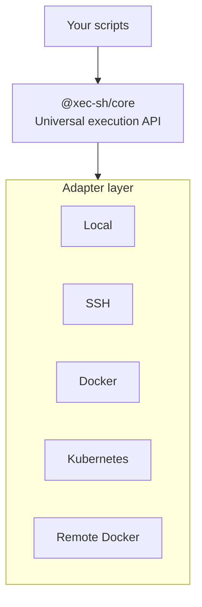

# Universal Command Execution for the Modern Stack {#universal-command-execution-for-the-modern-stack}

**One toolkit for scripts, project CLIs, orchestration and releases.**

Xec turns operational work into reusable TypeScript. Start with a script, expose it as a project command, compose a pipeline and publish a verified release. Local processes, SSH hosts, Docker containers and Kubernetes pods share the same execution API; each target retains its own shell, tools and security boundary.

## 🚀 Execute Anywhere with the Same API {#-execute-anywhere-with-the-same-api}

```typescript
// Execute anywhere with the same API
import { $ } from '@xec-sh/core';

// Local execution
await $`npm run build`;

// SSH execution with connection pooling
await $.ssh('prod-server')`systemctl restart app`;

// Docker container execution
await $.docker({ container: 'my-container' })`python manage.py migrate`;

// Kubernetes pod execution
await $.k8s('app-pod')`kubectl rollout status deployment/app`;
```

## 🎯 Or Use Declarative Configuration {#-or-use-declarative-configuration}

```yaml
# .xec/config.yaml
version: "1.0"

targets:
  hosts:
    prod:
      host: prod.example.com
      user: deploy
  containers:
    staging:
      container: staging-app
  pods:
    dev:
      namespace: development
      pod: app-pod

tasks:
  deploy:
    description: Deploy to all environments
    parallel: true
    steps:
      - name: Deploy to production
        target: hosts.prod
        command: ./deploy.sh
      - name: Deploy to staging
        target: containers.staging
        command: ./deploy.sh
      - name: Deploy to development
        target: pods.dev
        command: ./deploy.sh
```

## ✨ Key Features {#-key-features}

### 1. **Universal Execution Engine** {#1-universal-execution-engine}
Single API for all environments via @xec-sh/core - write once, execute anywhere.

### 2. **Multi-Environment Native** {#2-multi-environment-native}
A shared execution contract across local, SSH, Docker and Kubernetes. Command portability still depends on the target shell and installed programs.

### 3. **TypeScript Template Literals** {#3-typescript-template-literals}
Intuitive  $\`command\` syntax with full type safety and IntelliSense support.

### 4. **Enterprise Features** {#4-enterprise-features}
Built-in connection pooling, retry logic, error handling, and streaming output.

### 5. **Parallel Execution** {#5-parallel-execution}
Execute commands across multiple targets simultaneously with automatic orchestration.

### 6. **Flexible Approach** {#6-flexible-approach}
Use imperative TypeScript scripts or declarative YAML configuration - your choice.

## 📋 Real-World Use Cases {#-real-world-use-cases}

### **Multi-Environment Deployment** {#multi-environment-deployment}
> "Same code runs everywhere - local to cloud"

Deploy to development, staging, and production with a single command:
```typescript
await Promise.all([
  $.ssh('dev')`./deploy.sh`,
  $.docker({ container: 'staging' })`./deploy.sh`,
  $.k8s('prod')`./deploy.sh`
]);
```

### **Infrastructure Management** {#infrastructure-management}
> "Control servers, containers, and clusters"

Manage your entire infrastructure stack from one place:
```typescript
import { $, parallel } from '@xec-sh/core';

const outcome = await parallel(
  [$.ssh('deploy@web-1'), $.docker('api'), $.k8s('prod/api-pod')]
    .map(target => target`./health-check.sh`.nothrow()),
  { maxConcurrent: 3 }
);

console.log(`${outcome.succeeded.length} healthy, ${outcome.failed.length} not`);
```

### **CI/CD Pipelines** {#cicd-pipelines}
> "Build sophisticated deployment workflows"

Create powerful pipelines with error handling and rollback:
```typescript
try {
  await $`npm test`;
  await $`npm run build`;
  await $.ssh('prod')`deploy.sh`;
} catch (error) {
  await $.ssh('prod')`rollback.sh`;
  throw error;
}
```

### **DevOps Automation** {#devops-automation}
> "Automate operations with TypeScript safety"

Type-safe automation with full IDE support:
```typescript
interface DeployConfig {
  version: string;
  environment: 'dev' | 'staging' | 'prod';
  services: string[];
}

async function deploy(config: DeployConfig) {
  const { targets, quote } = await import('@xec-sh/ops');
  await targets.exec(`hosts.${config.environment}`,
    `./deploy.sh ${quote(config.version)} ${config.services.map(quote).join(' ')}`);
}
```

### **Cross-Platform Testing** {#cross-platform-testing}
> "Test on multiple environments simultaneously"

Run tests across different platforms in parallel:
```typescript
const testResults = await Promise.all([
  $`npm test`,
  $.docker({ image: 'node:22' })`npm test`,
  $.docker({ image: 'node:24' })`npm test`,
]);
```

### **Hybrid Cloud Operations** {#hybrid-cloud-operations}
> "Manage mixed infrastructure seamlessly"

Coordinate operations across cloud providers and on-premise:
```typescript
await $.ssh('aws-server')`backup.sh`;
await $.k8s('gcp-cluster')`backup.sh`;
await $.docker({ container: 'on-premise' })`backup.sh`;
```

## 🔄 How Xec Compares {#-how-xec-compares}

Choose tools by the responsibility they own. Xec handles TypeScript automation and execution; Turbo can retain package graph caching, Terraform provisioning state, and Ansible desired-state configuration. See the [comparison guide](./comparison.md) for explicit boundaries and primary references.

## 💡 Why Xec? {#-why-xec}

### Problems Xec Solves {#problems-xec-solves}

| Problem | Xec Solution |
|---------|--------------|
| **"Different APIs for local/remote execution"** | Single unified execution API |
| **"SSH connection management is complex"** | Built-in connection pooling |
| **"Docker commands are verbose"** | Simple $.docker() interface |
| **"Kubernetes kubectl is cumbersome"** | Intuitive $.k8s() execution |
| **"Can't execute across environments"** | Multi-target parallel execution |
| **"Error handling across systems is hard"** | Consistent Result pattern |
| **"No type safety in shell scripts"** | Full TypeScript with IntelliSense |

## 🎯 Who Uses Xec? {#-who-uses-xec}

- **DevOps Engineers** seeking unified command execution across environments
- **Backend Developers** executing commands in containers and remote servers
- **Platform Engineers** building internal developer platforms
- **SRE Teams** automating operations and incident response
- **System Administrators** managing distributed systems
- **JavaScript/TypeScript Developers** wanting type-safe shell scripting
- **CI/CD Pipeline Authors** building deployment scripts
- **Teams managing hybrid infrastructure** (local + cloud + containers)

## 🚀 Quick Start {#-quick-start}

### Installation {#installation}

```bash
# Install globally
npm install -g @xec-sh/cli

# Or add to your project
npm install @xec-sh/core
```

### Your First Script {#your-first-script}

Create `deploy.ts`:
```typescript
import { $ } from '@xec-sh/core';

// Build locally
await $`npm run build`;

// Test in Docker (ephemeral container)
await $.docker({ image: 'node:24', volumes: [`${process.cwd()}:/app`], workdir: '/app' })
  `npm test`;

// Deploy to production
const prod = $.ssh({ host: 'prod.example.com', username: 'deploy' });
await prod`docker pull myapp:latest`;
await prod`docker stop myapp || true`;
await prod`docker run -d --name myapp myapp:latest`;

// Verify deployment
const health = await prod`curl -s http://localhost/health`.text();
console.log('Health check:', health);
```

Run it:
```bash
xec deploy.ts
```

### Using Configuration {#using-configuration}

Create `.xec/config.yaml`:
```yaml
version: "1.0"
name: my-project

targets:
  hosts:
    staging:
      host: staging.example.com
      user: deploy
      port: 22

tasks:
  deploy:
    description: Deploy to staging
    target: hosts.staging
    steps:
      - name: Pull latest code
        command: git pull origin main
      - name: Install dependencies
        command: npm ci
      - name: Restart application
        command: pm2 restart app
```

Run it:
```bash
xec deploy
```

## 📚 Core Concepts {#-core-concepts}

### Execution Engine {#execution-engine}
The heart of Xec - a unified API that abstracts away environment differences while preserving full control.

### Adapters {#adapters}
Environment-specific implementations that handle the details of execution while maintaining a consistent interface.

### Targets {#targets}
Named execution contexts (local, SSH hosts, Docker containers, K8s pods) that can be referenced in scripts and tasks.

### Template Literals {#template-literals}
Natural command syntax using JavaScript's template literal feature for intuitive command composition.

## 🛠 Architecture {#-architecture}

Your scripts call one execution API; an adapter translates each command for the environment it runs in:



## 🔗 Next Steps {#-next-steps}

- **[Quick Start Guide](./quick-start.md)** - Get up and running in 5 minutes
- **[Core Concepts](./core-concepts.md)** - Understand Xec's architecture
- **[Command Reference](../commands/overview.md)** - Explore all available commands
- **[Examples & Recipes](../recipes/index.md)** - Real-world usage patterns
- **[API Documentation](../core/execution-engine/overview.md)** - Deep dive into the execution engine

## 🤝 Join the Community {#-join-the-community}

- **GitHub**: [github.com/xec-sh/xec](https://github.com/xec-sh/xec)

---

**Xec** - Execute Everywhere, Write Once in TypeScript
